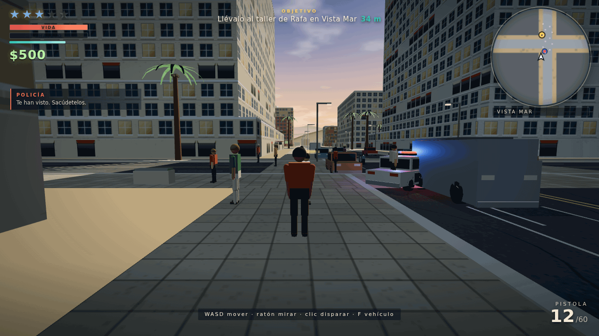
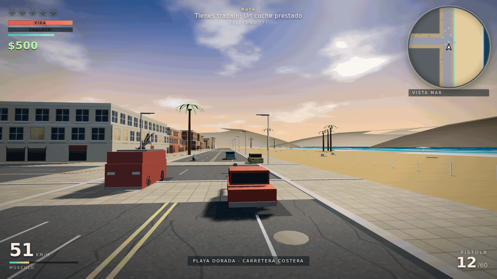
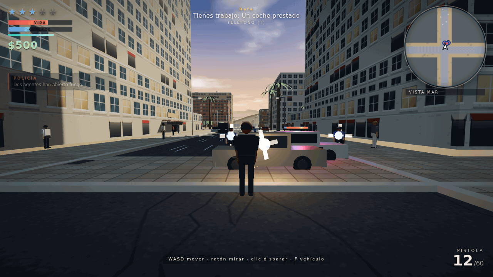
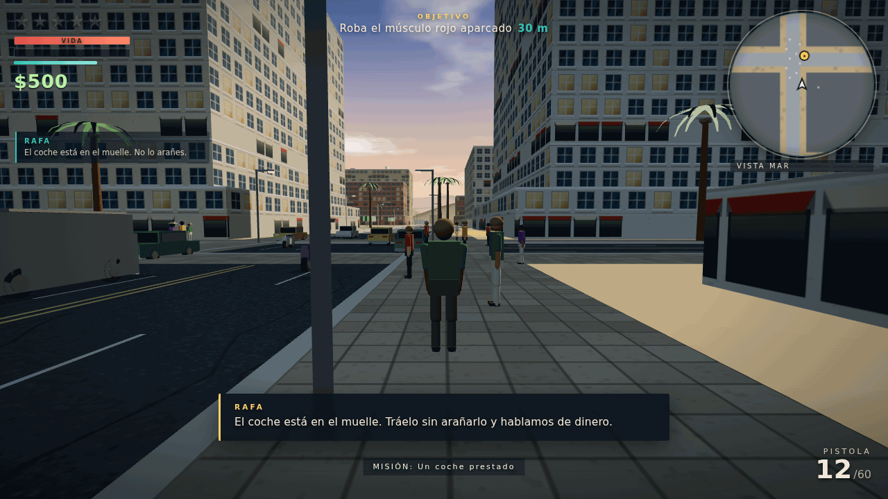

# CALA VERDE

[](https://make.fun/bounty/gta6-01?utm_source=github&utm_medium=readme&utm_campaign=gta6-01)
[](https://make.fun/bounty/gta6-01/leaderboard?utm_source=github&utm_medium=readme&utm_campaign=gta6-01)
[](https://make.fun/bounty/gta6-01?utm_source=github&utm_medium=readme&utm_campaign=gta6-01)

A sun-soaked open-world crime game that runs in a desktop browser tab with no build step and no
network connection. You are Nico Salas, back in your home town on the bay with a debt, a borrowed
pistol and a crew that is not entirely on your side. Cala Verde is an invented Mediterranean-American
coastal city — a downtown of glass towers, a low-rise Latin quarter of awnings and murals, a marina
full of yachts, a long beach lined with palms, a container port and a hillside of villas — laid out as
a walkable grid under a permanent golden hour. Steal any car on the street, outrun a wanted level that
climbs from a single curious patrol to a full pursuit, and work six story missions for a fixer, a
mechanic and a rival who is playing a longer game than you are.






## How to play

Open `game/index.html` in desktop Chrome. Everything it needs is a file beside it, so it plays with
the network switched off. To serve it locally instead:

```
node serve.ts --port 8099
```

then open `http://127.0.0.1:8099/`.

## Controls

| Action | Key |
| --- | --- |
| Move | `W` `A` `S` `D` |
| Sprint | `Shift` |
| Jump | `Space` |
| Look | Mouse |
| Fire | Left mouse button |
| Aim | Right mouse button |
| Enter / exit vehicle | `E` |
| Cycle weapon | `Q` |
| Map | `Tab` or `M` |
| Interact | `F` |
| Phone / mission dialogue | `T` |
| Pause | `Esc` |

## What is in it

- **Player** — a low-poly character with animated limbs (idle, walk, run, sprint, jump, fall, enter
  and exit a vehicle, aim, shoot, hit, die) and a collision-aware third-person camera that kicks its
  field of view out when you sprint.
- **Vehicles** — arcade physics with an acceleration curve, braking, reverse, speed-sensitive
  steering, a handbrake drift with skid marks and tyre smoke, suspension bob, damage, a horn and a
  radio. Five types: sedan, muscle car, sports car, van and police cruiser, plus a motorbike. Any
  parked or occupied car can be stolen and the driver pulled out.
- **Traffic** — 25-40 vehicles following the lane graph, stopping at red lights and for obstacles,
  turning at junctions, honking, and panicking when a shot is fired or a car is stolen.
- **Pedestrians** — walkers on the sidewalks who cross at crosswalks, idle on phones and benches,
  flee from gunfire and speeding cars, and react to a punch.
- **Police and the wanted level** — zero to five stars. One star sends a patrol to investigate;
  two and three bring cruisers that chase and officers who fight on foot; four and five add more
  units and roadblocks. The level rises with witnessed crimes and decays once you break line of sight
  and leave the search radius. Getting caught or killed shows a BUSTED or WASTED screen and respawns
  you at the station or the hospital with a fee.
- **Combat** — hitscan pistol, SMG and shotgun with spread, recoil, muzzle flashes, tracers, impact
  sparks and decals, reloading with ammo counts, a melee punch, and health and armour pickups.
- **Missions and story** — six story missions in a chain with a named cast, told in short in-game
  dialogue with portraits drawn in code: mission markers in the world and on the minimap, objective
  text, timers, a chase, a delivery, a protection job, a robbery, a betrayal and a finale. Plus three
  repeatable side jobs: a time trial, a courier run and a bounty.
- **HUD** — health and armour bars, a rolling cash counter, wanted stars, weapon and ammo, an
  objective line, a live canvas minimap with the player's heading wedge, mission markers, police blips
  and a search cone, a speedometer and gear readout while driving, and a notification feed.
- **Menus** — title screen, pause menu, a full-screen map with a legend, settings for quality, volume,
  inverted look and sensitivity, and a save slot in `localStorage` that restores cash, mission index,
  position and wanted level.
- **Audio** — all procedural WebAudio: engine hum and gear changes, tyre squeal, gunshots, sirens that
  pan with distance, footsteps, UI clicks, ocean ambience, seagulls, and an original music loop that
  ducks under dialogue.
- **Effects** — a gradient sky with a sun disc, haze-matched fog, water with moving specular and foam
  at the shoreline, long shadows from a single directional light, dust and tyre smoke, sparks, muzzle
  light, screen shake and a vignette.

## Layout

```
game/index.html             page shell, import map, HUD roots, CSS
game/src/main.js            boot, screen state machine, fixed-step loop, wiring
game/src/config.js          every tuning number and palette colour
game/src/random.js          seeded RNG
game/src/state.js           the shared state object and event bus
game/src/city/              layout, roads, buildings, props, water, colliders
game/src/render/            renderer and sky, particles, minimap, HUD, screens
game/src/systems/           input, player, camera, vehicles, traffic, pedestrians,
                            police, combat, missions, save, audio
game/src/data/              missions and cast, vehicle specs, invented names
game/src/shots.js           deterministic screenshot scenes (?shot=)
tools/shoot.mjs             headless Chrome screenshot capture
tools/verify-build.mjs      gate and screenshot verification
```

## Systems in detail

The city is a 1.2 km grid laid out from a single seed, so every playthrough draws the same streets.
Six districts sit on it: a downtown of glass towers, a low-rise Latin quarter of awnings and murals,
a marina of yachts and moorings, a beach promenade lined with palms, a container port with stacked
freight, and a hillside of villas above the bay. Roads come from a lane graph, so traffic keeps to
its side, stops at red lights, queues behind an obstacle, turns at junctions and honks when the
player blocks it. Pedestrians walk the sidewalks, cross at crosswalks, idle on benches and phones,
and scatter when a shot is fired or a car mounts the kerb.

Vehicles use arcade physics with a separate acceleration curve per class: a sedan that understeers,
a muscle car that breaks traction under throttle, a sports car with a short gear spread, a van that
wallows, and a police cruiser tuned to close a gap. The handbrake turns any of them into a drift
with skid marks and tyre smoke, and damage accumulates per panel as the engine note drops.

The wanted level runs from zero to five stars. One star sends a patrol to look; two and three bring
cruisers that chase and officers who fight on foot; four and five add units and roadblocks. It rises
only on witnessed crimes and decays once the player breaks line of sight and leaves the search
radius, which the minimap shows as a cone.

Combat is hitscan with spread, recoil, tracers, impact sparks and decals, over a pistol, an SMG and a
shotgun, plus a melee punch and health and armour pickups. Six story missions chain a named cast
through a chase, a delivery, a protection job, a robbery, a betrayal and a finale, with three
repeatable side jobs on top. Progress saves to localStorage and restores cash, mission index,
position and wanted level.

Every sound is synthesised at runtime with WebAudio - engine hum and gear changes, tyre squeal,
gunshots, sirens that pan with distance, footsteps, ocean ambience and an original music loop that
ducks under dialogue - so the game ships with no audio files at all.

## Building the entry

```
mkdir -p out && MAKEFUN_OUTPUT_DIR=out node main.ts
```

writes `out/game/`, `out/screenshots/` and `out/dossier.json`. The same command with no
`MAKEFUN_OUTPUT_DIR` writes to `/output`, which is what the grader reads.

<p>
  
</p>

Built for [make.fun](https://make.fun).

## License

MIT. See `LICENSE`.
